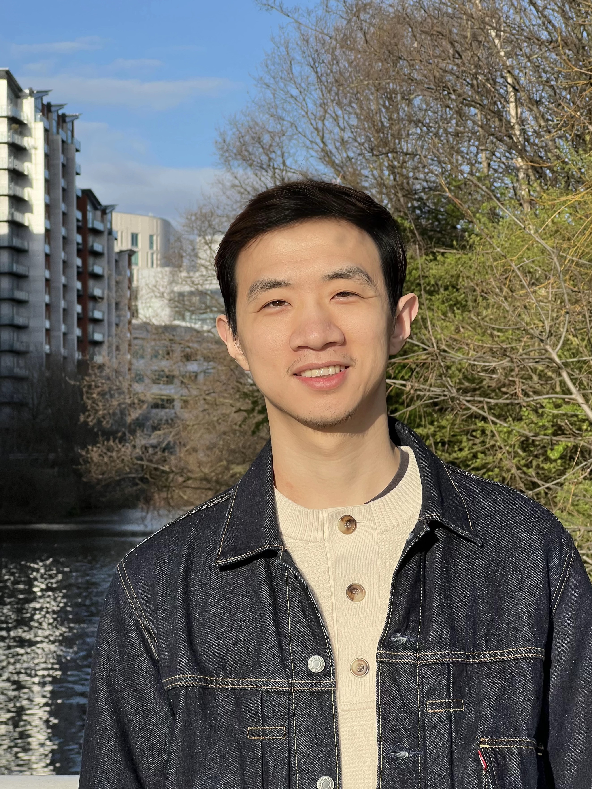
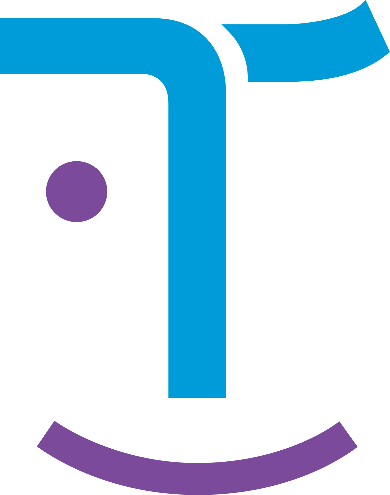

  

    

      
    

    

      
Chenghao Qian

      
<i class="fab fa-github" style="color: var(--global-text-color); font-size: 1.05em;"></i> <a href="https://github.com/Jumponthemoon" style="color: inherit;"></a>_

      
Ph.D. Student

      

        
        <a href="https://uolds.leeds.ac.uk/">University of Leeds</a>
      

      
Visiting Researcher

      

        
        <a href="https://www.cam.ac.uk/">University of Cambridge</a>
      

    

  

  

    

      <h2 id="about-me">About me</h2>
      

        <a href="https://github.com/Jumponthemoon" title="GitHub"><i class="fab fa-github"></i></a>
        <a href="https://www.linkedin.com/in/chenghao-qian-021263240/" title="LinkedIn"><i class="fab fa-linkedin"></i></a>
        <a href="https://scholar.google.com/citations?user=EFV2q-4AAAAJ&hl=en" title="Google Scholar"><i class="ai ai-google-scholar"></i></a>
        <a href="https://www.photocrowd.com/photographer-community/293596/?page=images" title="Gallery"><i class="fas fa-camera"></i></a>
      

    

    
I am currently pursuing a Ph.D. at <a href='https://uolds.leeds.ac.uk/'><u>Virtuocity</u></a>, and a visiting researcher at the <a href='https://www.cam.ac.uk/'><u>University of Cambridge</u></a>. I completed my master's degree at the <a href='https://www.sydney.edu.au/'><u>University of Sydney</u></a> and had industrial experience working in the fields of <strong style="color: #1772d0;">robotics</strong> and <strong style="color: #1772d0;">autonomous driving</strong>.

  


  Research callout temporarily hidden -- delete this comment wrapper to bring it back.



My works aim to bridge <strong style="color: #1772d0;">generative models</strong> and <strong style="color: #1772d0;">embodied agents</strong> to build systems that <strong style="color: #1772d0;">👁️ perceive</strong>, <strong style="color: #1772d0;">🧠 reason</strong>, and <strong style="color: #1772d0;">🤖 act</strong> safely in the real world.



  

    <h3>Experience</h3>
    

      

        
        <a href="https://paralleldomain.com/">Parallel Domain</a>
        ·
        Research Intern
      

      

        
        <a href="https://www.xpeng.com/">XPENG Robotics</a>
        ·
        Sr. Algorithm Engineer
      

      

        
        <a href="https://www.ubtrobot.com/en/">UBTech Robotics</a>
        ·
        Algorithm Engineer
      

    

  

  

    <h3>Research Interests</h3>
    <ul>
      <li>3D & Video World Models</li>
      <li>Physics-guided Generation</li>
      <li>Inverse Modelling</li>
      <li>Robust Perception</li>
    </ul>
  

I am <strong style="color: #1772d0;">open to research collaborations</strong>. Please feel free to contact me at <a href="mailto:tscq@leeds.ac.uk" style="color: #1772d0;">tscq@leeds.ac.uk</a>.
